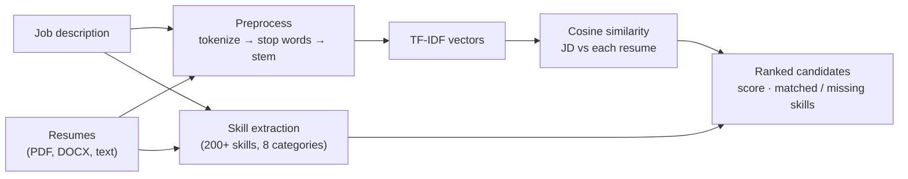

# NLP Resume Parser & Matcher

[](https://github.com/priyxnshu07/resume-matcher-analytics/actions/workflows/ci.yml)


Rank resumes against a job description using **TF-IDF** and **cosine similarity**, with every core NLP algorithm written from scratch in Python. The project also **measures how well the matcher works** on 166 real resumes.

---

## The project in brief (STAR)

**Situation.** Recruiters screen hundreds of resumes per opening. Keyword tools are fast but opaque, and it's rarely shown whether their scores can be trusted.

**Task.** Build a transparent resume matcher with the NLP implemented from scratch, then test it on real data.

**Action.**
- Implemented tokenization, stop-word removal, a Porter stemmer, TF-IDF and cosine similarity using only `math`, `re` and `collections`.
- Built a Streamlit dashboard: rankings, skill gaps, and the full math behind every score.
- Evaluated the matcher on a public dataset of resumes labelled by job category, which uncovered and fixed two bugs.

**Result.** The matcher ranks the right resume first **84%** of the time in a pool of 5. After the fixes, scores **match scikit-learn exactly**, and an unrelated resume no longer shows as a strong match (**88% → 0%** of cases).

---

## How it works



| Algorithm | Formula | Module |
|---|---|---|
| Term frequency | `TF(t,d) = count(t in d) / total_terms(d)` | `src/vectorization/tf.py` |
| Inverse document frequency | `IDF(t) = log((1 + N) / (1 + df(t))) + 1` | `src/vectorization/idf.py` |
| TF-IDF | `TF-IDF(t,d) = TF × IDF` | `src/vectorization/tfidf.py` |
| Cosine similarity | `cos(A,B) = (A·B) / (‖A‖ × ‖B‖)` | `src/similarity/cosine.py` |
| Porter stemmer | 25 suffix-stripping rules | `src/preprocessing/stemmer.py` |
| Tokenizer | Regex-based cleaning | `src/preprocessing/tokenizer.py` |
| Stop words | Hand-crafted 120+ word list | `src/preprocessing/stopwords.py` |

---

## Does it actually work? (evaluation)

Tested on the public [Kaggle Resume Dataset](https://www.kaggle.com/datasets/gauravduttakiit/resume-dataset): 25 job categories. Each resume is used as the job description in turn; a good matcher ranks resumes from the **same category** first. Run it with `python -m evaluation.evaluate`; the results are on the dashboard's **Model Evaluation** page.

| Metric | Original | Fixed |
|---|---|---|
| Right resume ranked #1, pool of 5 (a recruiter's upload) | 85% | 84% |
| Precision@5 across all 166 resumes (random: 4%) | 68% | 64% |
| One unrelated resume uploaded, scored over 50% | **88%** | **0%** |
| Resumes wrongly tagged with the skill "R" | **100%** | 7% |

**Findings**
- **The dataset is 83% duplicates:** only 166 of its 962 rows are unique resumes. A model trained on it without de-duplication can be tested on resumes it has already seen, which inflates accuracy.
- **Ranking was already good; the scores weren't trustworthy.** The original IDF, `log(N / (1 + df))`, is 0 for a word in all but one document and negative for a word in every document. With one job and one resume (N = 2), every word only one of them uses gets 0 and is ignored, so any overlap scored near 100%: a chef with "Python hobbyist" was a **100% match** for a data scientist. Scores also changed depending on which other resumes were uploaded.
- **Skill tagging matched letters inside words:** "reading at Google on javascript" found Java, Go and R. Skills now match whole words only (9.0 → 6.3 skills per resume on average).
- **Keyword matching has a ceiling:** roles with distinct vocabularies (Hadoop, Civil Engineer, Database) score 90–100% precision@5. Roles that share words (DevOps, Testing, Web Designing) score under 20%. Telling those apart needs meaning, not keywords, e.g. sentence embeddings.

Limitations: 166 resumes is a small sample, so differences of a few points are noise. Category labels are a stand-in for "relevant": a Python Developer can be a fine fit for a Data Science role.

---

## Run it

```bash
python -m venv .venv && source .venv/bin/activate
pip install -r requirements.txt
streamlit run app.py              # dashboard at http://localhost:8501
python -m evaluation.evaluate     # re-run the evaluation (downloads the dataset)
pytest                            # 63 tests
jupyter notebook notebooks/walkthrough.ipynb   # the math, step by step
```

On the dashboard, tick **"Use sample Job Description"** and **"Include pre-loaded sample resumes"**, then click **Run**.

## Dashboard

| Page / tab | What it shows |
|---|---|
| **Candidate Rankings** | Leaderboard by cosine similarity, skills per candidate, CSV export |
| **Skills Analysis** | Matched, missing and bonus skills for each resume |
| **How It Works** | Live TF-IDF vectors, dot-product breakdown, per-term contribution |
| **Visualizations** | Score comparison, skill gaps, similarity vs skill match |
| **Model Evaluation** | Accuracy before vs after the fixes, accuracy by role, skill false positives, top skills by role |

## Testing

- **Algorithms:** tokenizer, stemmer, TF, IDF, TF-IDF and cosine, each with hand-computed cases.
- **Cross-check:** similarity scores match scikit-learn's `TfidfVectorizer` to 9 decimal places.
- **Regression tests:** one per fixed bug, each verified to fail on the original code.
- **Smoke tests:** both dashboard pages run end to end.
- **CI** runs everything on every push.

## Project structure

```text
├── app.py                    # Streamlit dashboard
├── pages/                    # Model Evaluation page
├── src/
│   ├── preprocessing/        # Tokenizer · stop words · stemmer
│   ├── vectorization/        # TF · IDF · TF-IDF
│   ├── similarity/           # Cosine similarity · ranking pipeline · skill extraction
│   └── parsers/              # PDF and DOCX text extraction
├── evaluation/evaluate.py    # Evaluation on the labelled resume dataset
├── reports/                  # Evaluation results (CSV)
├── data/                     # Sample resumes and JDs, skills database
├── notebooks/walkthrough.ipynb
└── tests/
```

## Tech stack

Python · Streamlit · Plotly · pandas · pdfplumber · python-docx · pytest · GitHub Actions. scikit-learn is used only in tests, to cross-check the from-scratch maths.
